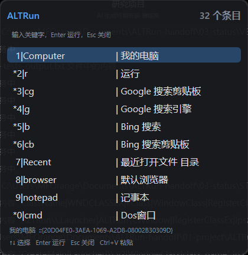
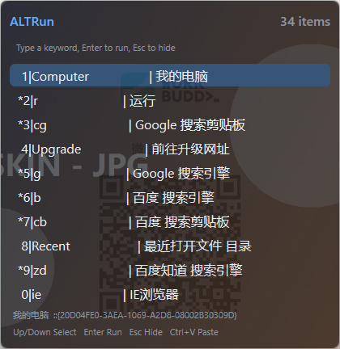
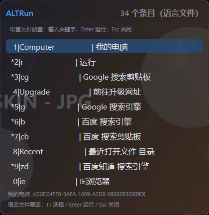
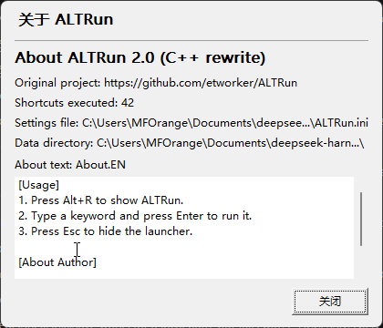
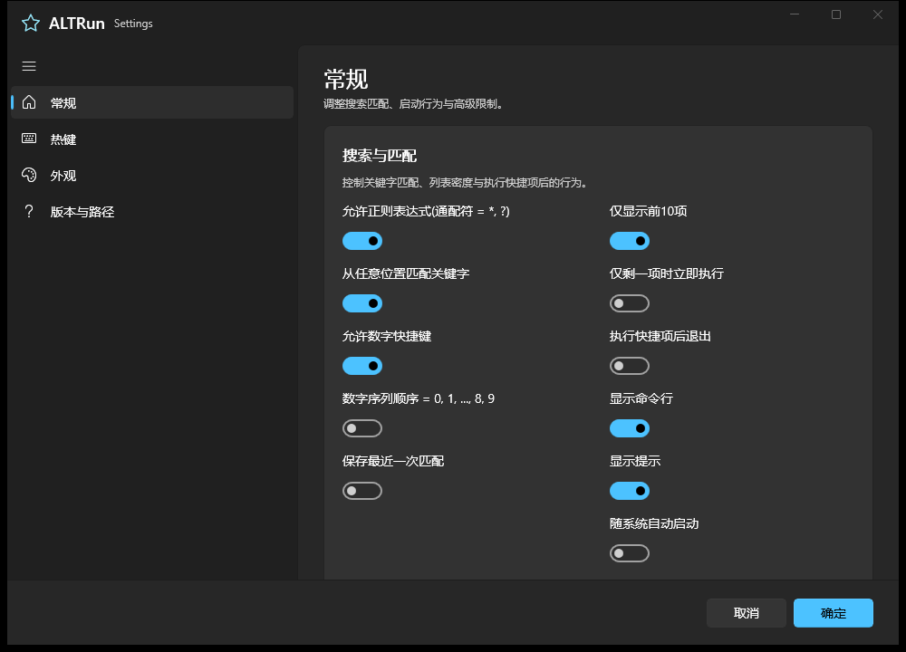
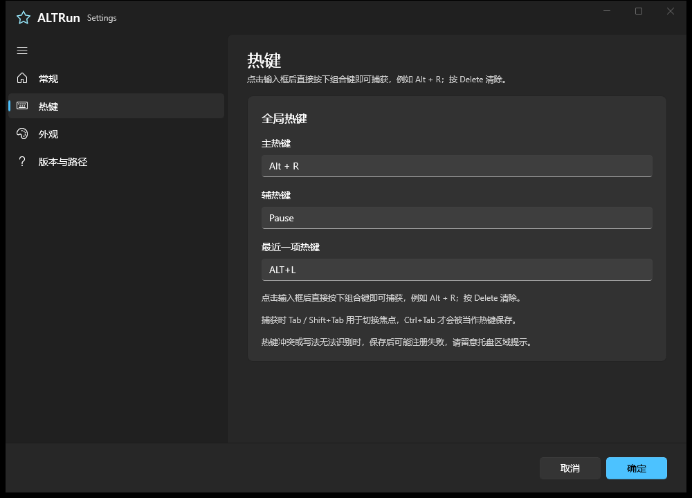
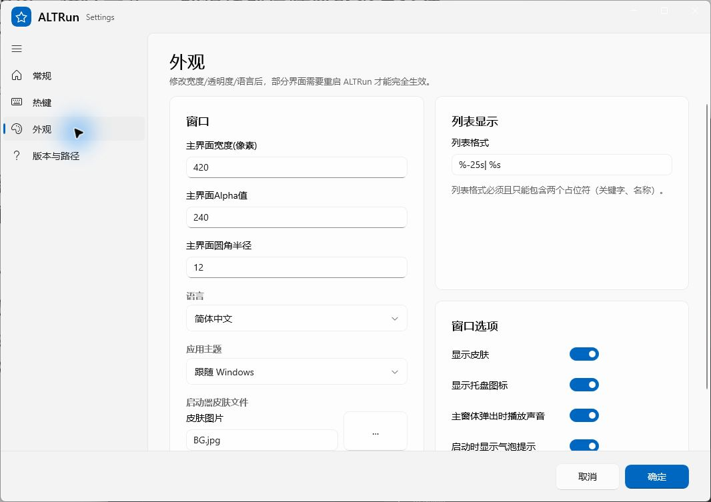
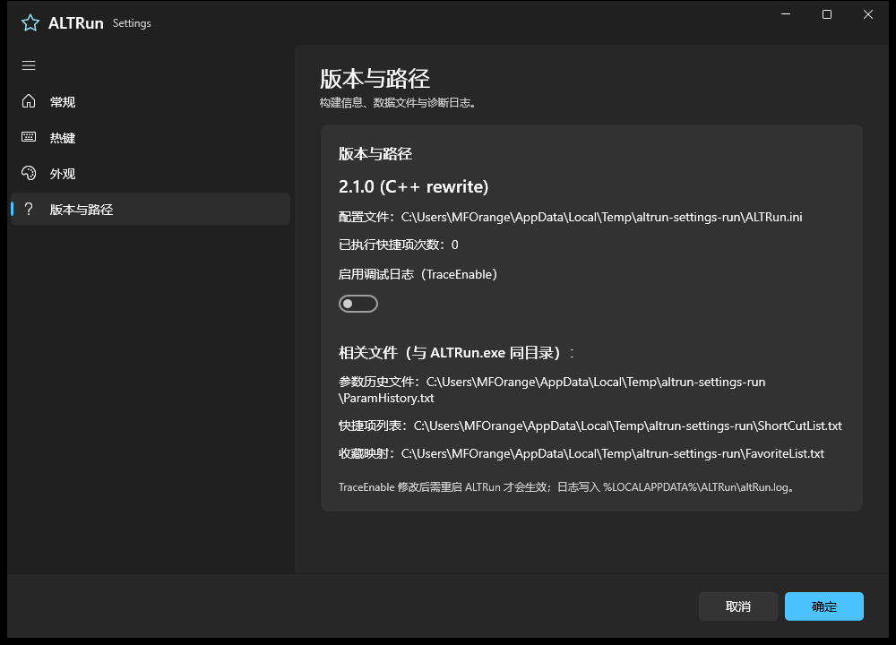
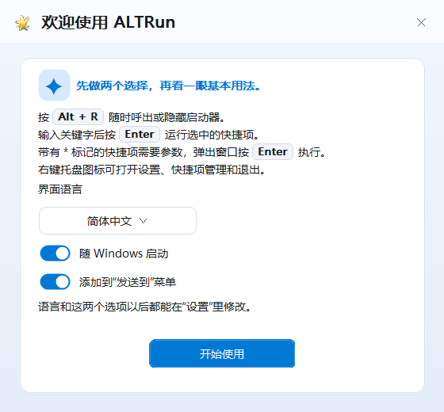
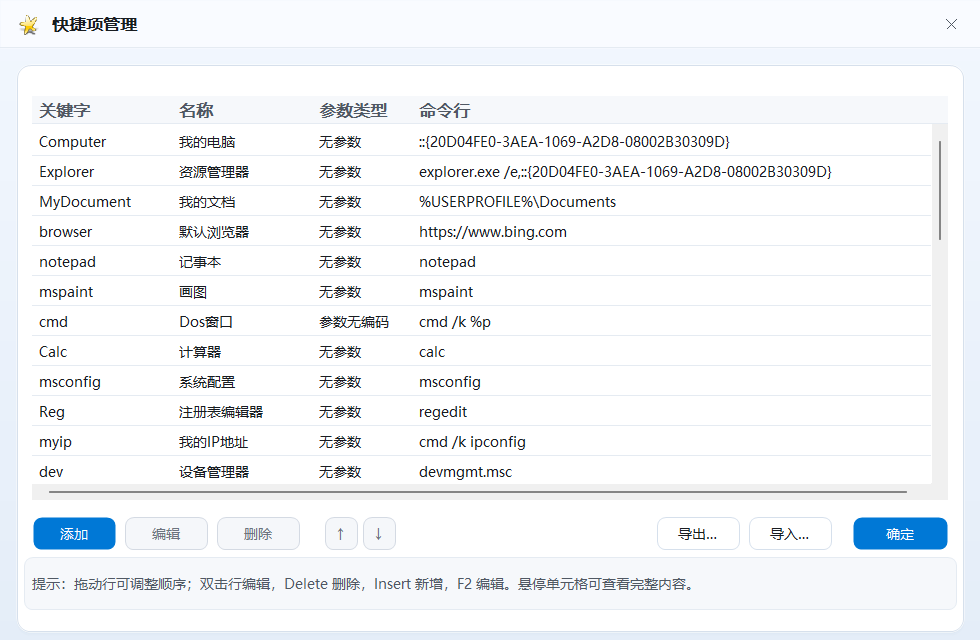

# ALTRun（C++ 重写版）

> 当前发布：**2.1.3**（Win64 便携版）。本页截图与功能说明对应当前源码和最新发布包。

> 一个 Windows 快速启动器：按 `Alt + R` 唤出，输入几个字母即可启动程序、打开文件/网址。
>
> 本仓库是 [etworker/ALTRun](https://github.com/etworker/ALTRun)（Delphi 2007，2016 年停更）
> 的 **C++20 重写版本**：核心、托盘和启动器为纯 Win32 + Direct2D，
> 设置与关于为独立 WinUI 3（C++/WinRT）程序。



> 启动器由主程序原生 D2D 绘制；搜索框、结果数量徽章、按钮反馈和 Fluent 视觉细节已更新。

参数输入窗（带全局参数历史）：


M5 外观与系统集成：

| 皮肤背景 | 多语言 | 关于与路径（WinUI 3） |
|---|---|---|
|  |  |  |

设置页使用独立的 **WinUI 3** 程序（`ALTRun.Settings.exe`，C++/WinRT），下面是真实运行截图：



| 热键页 | 外观页（主题/皮肤） | 版本与路径（可打开路径） |
|---|---|---|
|  |  |  |

首启向导与快捷项管理器仍由主程序承载；首启向导使用原生语言下拉，设置页保留上一版语言菜单交互：

| 首启向导 | 语言菜单 |
|---|---|
|  |  |



## 特性（已完成）

- 全局热键唤出（默认 `Alt + R`，可配第二热键），单实例，托盘图标
- 正则 / 通配匹配（`*`、`?`），复刻原版打分公式与 `Sort()` 排序
- 快捷项列表、收藏记忆（`RememberFavouratMatch`）、使用次数（Freq）
- 数字键 1–9、0 直接执行对应条目（`NumberKey` / `IndexFrom0to9`）
- 可配置结果行格式（`ListFormat`：`%-25s| %s`、`%s (%s)`、`%s [%s]`）
- 执行：环境变量、`@`/`@+`/`@-` 显示前缀、参数占位符、`URL_Query`/`UTF8_Query` 编码、
  ShellExecute 失败自动降级 WinExec
- 参数窗：需要参数的条目先弹窗输入，全局参数历史（次数排序、满额淘汰最早项），
  Enter 确认 / Esc 两段式 / 空闲自动取消
- 最近列表：`Ctrl+L` 查看、`ALT+L` 直接执行最近项（不增加 Freq）
- `ExecuteIfOnlyOne`、输入末尾空格、`;`、`'` 等原版快捷执行方式
- 设置与关于（`--config`、`--about` 或托盘菜单）：独立 `ALTRun.Settings.exe`，WinUI 3 导航页
  常规 / 热键 / 外观 / 版本与路径，热键按键捕获，保存后通过 `WM_APP+30` 通知主程序立即生效；
  外观页提供跟随 Windows / 浅色 / 深色主题、皮肤文件选择和对齐的输入控件。
- 关于页的配置文件、参数历史、快捷项列表和收藏映射路径均可直接点击打开；文件不存在时打开所在目录。
  找不到设置程序或缺 Windows App Runtime 时回退旧的原生设置窗口
- 快捷项管理器（托盘菜单或 `--manager`）：四列表格增删改、拖拽排序、拖放添加、
  `.lnk` 解析、相对/绝对路径转换、导入/导出，编辑后立即写回 `ShortCutList.txt`
- **数据格式与旧版逐字节兼容**：`ShortCutList.txt`（GBK）、`FavoriteList.txt`、
  `ParamHistory.txt`、`ALTRun.ini`（含 `[DEBUG] LatestList`）
- 绿色便携：应用配置与数据都在 exe 同目录；唯一的注册表写入是 Windows 11
  通知图标的可见性 `IsPromoted`（首次注册时设一次，用户之后手动关掉不再覆盖）
- 托盘图标使用原版星形 `Carracho.ico`（内嵌 `IDI_ALTRUN`，窗口类/托盘/Alt+Tab 一致）；
  启动时重试、Explorer 重启后自动重建；Win11 首次注册自动放到可见区；
  若程序位于 Low 完整性目录导致 Shell 拒绝图标，则自动显示启动器而不再静默驻留
- 默认快捷项已现代化：默认浏览器（Bing 首页）、Bing/Google 搜索、Bing 图片、
  Bilibili、知乎、Bing/Google 剪贴板搜索；不含升级网址、百度知道或 IE
- 中文界面与 IME 输入、Win11 圆角暗色窗口
- 三种内置语言：`[GUI] Lang=zh_cn` / `zh_hk` / `en_us`，整窗切换
  （5 个窗口 + 托盘 + 默认列表名）；原版 224 键三语言表内置，不再读取外置
  `.lang` 或 `About.<Lang>` 文件，旧 `EN` / `简体中文` 配置自动迁移
- 首次启动向导：按系统语言预选界面语言、原生下拉切换语言、询问随 Windows 启动 / 发送到菜单，
  并给出热键、搜索、参数星号和托盘菜单四条用法
- 结果列表按像素列对齐（不再依赖空格填充），超长名称以省略号截断；12pt/14pt 比例字体均可
- M5：JPG/PNG/BMP 皮肤、字体串解析、Popup.wav、SendTo 快捷方式、关于窗口
- M6：核心单元测试、CTest、GBK 兼容验证、可复现的 win64 便携版打包脚本；当前验证为 **1137 checks / 0 failure(s)**

## 构建

需要 Visual Studio（MSVC + Windows SDK）、CMake ≥ 3.28，以及
**Windows App Runtime 1.7+ / 2.x**（WinUI 3 设置程序运行所需，Windows 11 一般已预装）：

```powershell
cmake -S . -B build -G "Visual Studio 18 2026" -A x64
cmake --build build --config Release --target ALTRun
& "C:\Program Files\Microsoft Visual Studio\18\Community\MSBuild\Current\Bin\MSBuild.exe" `
  src/settings/ALTRun.Settings.vcxproj /p:Configuration=Release /p:Platform=x64
```

主程序产物 `build/Release/ALTRun.exe`；WinUI 设置程序产物
`build/settings/x64/Release/ALTRun.Settings.exe`。两者必须放在同一目录，
设置程序才能读写同一份 `ALTRun.ini`，并通过窗口消息通知主程序重载。

运行后在同目录生成 `ALTRun.ini`、`ShortCutList.txt`、`FavoriteList.txt`、`altRun.log`。

开发调试：`ALTRun.exe --show` 直接显示启动器窗口，`--config` 打开 WinUI 设置，
`--manager` 打开快捷项管理器，`--about` 打开版本与路径页。
`ALTRun.Settings.exe --page general|hotkey|appearance|about` 可直达指定页。

## 文档

- [使用说明](docs/USAGE.md)：热键、搜索语法、参数、最近列表、设置、管理器、数据文件与迁移
- [发布包脚本](scripts/package.ps1)：一键构建并生成 win64 便携 ZIP
- [架构设计](docs/ARCHITECTURE.md)：分层、数据模型、匹配/执行流程、刻意差异
- [重写路线图](docs/ROADMAP.md)：M0–M6 里程碑与验收标准
- 逆向规格（原 Delphi 行为，带源码行号）：
  [主窗口与匹配](docs/spec/01-main-window.md)、
  [配置项](docs/spec/02-config-options.md)、
  [快捷项模型](docs/spec/03-shortcut-model.md)、
  [辅助功能](docs/spec/04-aux-features.md)

## 目录结构

```
src/app      进程编排：单实例、热键、托盘、设置
src/core     纯逻辑：编码、数据模型、存储、匹配、格式化、执行、日志
src/ui       Win32 窗口 + Direct2D 绘制
src/settings WinUI 3 设置程序（C++/WinRT + XAML）
docs/        架构、路线图、逆向规格
resources/   运行时资源（皮肤、语言）
src/         源码；应用图标 `ALTRun.ico` + `ALTRun.rc` 也在这里
```

## 状态

2.1.3：在 WinUI 3 设置基础上完成外观主题/皮肤入口、皮肤控件对齐、关于页路径打开，
并保留首启向导与原生启动器的现有交互。主程序保留原生核心、托盘和 D2D 启动器。
里程碑 M0–M13 已完成当前计划项，后续增强项见 [ROADMAP.md](docs/ROADMAP.md)。

## 许可

原项目 ALTRun 未附带许可证；本重写版沿用其行为与数据结构，请在遵循原仓库约束的前提下使用。
