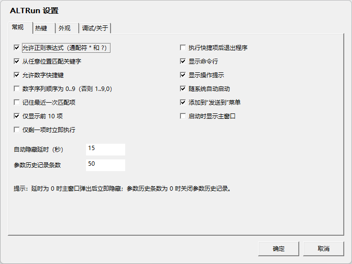
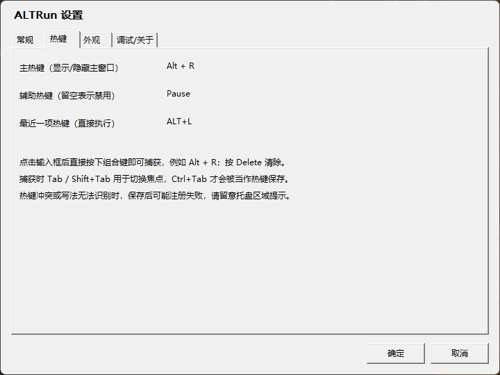
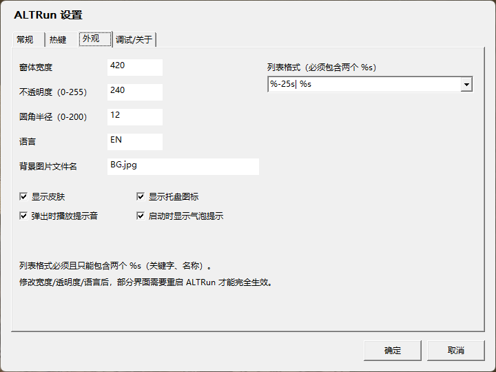

# ALTRun（C++ 重写版）

> 一个 Windows 快速启动器：按 `Alt + R` 唤出，输入几个字母即可启动程序、打开文件/网址。
>
> 本仓库是 [etworker/ALTRun](https://github.com/etworker/ALTRun)（Delphi 2007，2016 年停更）
> 的 **C++20 + 纯 Win32 + Direct2D** 重写版本，目标是功能 1:1 移植并修正原实现缺陷。


参数输入窗（带全局参数历史）：


设置窗口（四个页签，热键按键捕获）：



| 热键页 | 外观页 |
|---|---|
|  |  |

## 特性（已完成）

- 全局热键唤出（默认 `Alt + R`，可配第二热键），单实例，托盘图标
- 正则 / 通配匹配（`*`、`?`），复刻原版打分公式与 `Sort()` 排序
- 快捷项列表、收藏记忆（`RememberFavouratMatch`）、使用次数（Freq）
- 数字键 1–9、0 直接执行对应条目（`NumberKey` / `IndexFrom0to9`）
- 可配置结果行格式（`ListFormat`：`%-25s| %s`、`%s (%s)`、`%s [%s]`）
- 执行：环境变量、`@`/`@+`/`@-` 显示前缀、参数占位符、`URL_Query`/`UTF8_Query` 编码、
  ShellExecute 失败自动降级 WinExec
- 参数窗：需要参数的条目先弹窗输入，全局参数历史（次数排序、满额淘汰最早项），
  Enter 确认 / Esc 两段式 / 空闲自动取消
- 最近列表：`Ctrl+L` 查看、`ALT+L` 直接执行最近项（不增加 Freq）
- `ExecuteIfOnlyOne`、输入末尾空格、`;`、`'` 等原版快捷执行方式
- 设置窗口（`--config` 或托盘菜单）：常规 / 热键 / 外观 / 调试·关于 四页，
  热键可直接按键捕获，确定后立即生效并写回 `ALTRun.ini`
- **数据格式与旧版逐字节兼容**：`ShortCutList.txt`（GBK）、`FavoriteList.txt`、
  `ParamHistory.txt`、`ALTRun.ini`（含 `[DEBUG] LatestList`）
- 绿色便携：所有配置与数据都在 exe 同目录，不写注册表配置
- 中文界面与 IME 输入、Win11 圆角暗色窗口

## 构建

需要 Visual Studio（MSVC + Windows SDK）和 CMake ≥ 3.28：

```powershell
cmake -S . -B build/vs -G "Visual Studio 18 2026" -A x64
cmake --build build/vs --config Release
```

或使用预设（Ninja）：`cmake --preset msvc-release`、`cmake --build --preset release`。

产物 `build/vs/Release/ALTRun.exe`；运行后在同目录生成 `ALTRun.ini`、
`ShortCutList.txt`、`FavoriteList.txt`、`altRun.log`。

开发调试：`ALTRun.exe --show` 直接显示启动器窗口。

## 文档

- [架构设计](docs/ARCHITECTURE.md)：分层、数据模型、匹配/执行流程、刻意差异
- [重写路线图](docs/ROADMAP.md)：M0–M6 里程碑与验收标准
- 逆向规格（原 Delphi 行为，带源码行号）：
  [主窗口与匹配](docs/spec/01-main-window.md)、
  [配置项](docs/spec/02-config-options.md)、
  [快捷项模型](docs/spec/03-shortcut-model.md)、
  [辅助功能](docs/spec/04-aux-features.md)

## 目录结构

```
src/app    进程编排：单实例、热键、托盘、设置
src/core   纯逻辑：编码、数据模型、存储、匹配、格式化、执行、日志
src/ui     Win32 窗口 + Direct2D 绘制
docs/      架构、路线图、逆向规格
resources/ 运行时资源（皮肤、语言、图标，M5 使用）
```

## 状态

里程碑 M0（规格）、M1（可运行骨架）、M2（参数窗 / 参数历史 / 最近列表）、
M3（设置界面）完成；快捷项管理、皮肤/多语言、单元测试与打包正在按
[ROADMAP.md](docs/ROADMAP.md) 推进。

## 许可

原项目 ALTRun 未附带许可证；本重写版沿用其行为与数据结构，请在遵循原仓库约束的前提下使用。
