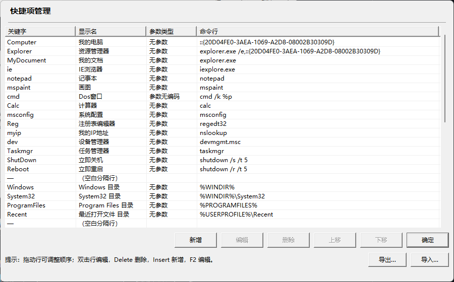

# ALTRun 使用说明

ALTRun 是一个 Windows 快速启动器：按 `Alt + R` 唤出输入框，输入几个字母即可启动程序、
打开文件/文件夹/网址。本版本是原 Delphi 版（2016 年停更）的 C++ 重写版，**数据格式与
旧版完全兼容**，可直接替换旧的 `ALTRun.exe` 使用。

---

## 1. 第一次运行

1. 把 `ALTRun.exe` 放在任意目录（**绿色便携**，不需要安装）。
2. 双击运行后，程序常驻托盘（若托盘图标未显示，见第 7 节）。
3. 按 `Alt + R` 唤出启动器。

首次运行会在 exe 同目录生成：

| 文件 | 内容 |
|---|---|
| `ALTRun.ini` | 全部配置（键名与旧版一致） |
| `ShortCutList.txt` | 快捷项列表（**GBK 编码**，旧版可直接读写） |
| `ShortCutList.txt.bak` | 上一次保存的备份 |
| `FavoriteList.txt` | "某关键字上次执行了哪一项"的收藏映射 |
| `ParamHistory.txt` | 参数历史（`次数\|参数`） |
| `altRun.log` | 运行日志（`TraceEnable=1` 时更详细） |

> 从旧版迁移：把旧目录里的 `ALTRun.ini`、`ShortCutList.txt`、`FavoriteList.txt`、
> `ParamHistory.txt` 复制到新 exe 旁边即可，无需转换。

## 2. 主界面

```
┌──────────────────────────────────────────────┐
│ ALTRun                              34 items │
│ note_                                        │  ← 输入行（光标处）
│ 1|notepad          | 记事本                  │  ← 结果行，数字前缀
│ *2|g              | Google 搜索引擎          │      * = 该条需要输入参数
│ 我的电脑  ::{20D04FE0-3AEA-1069-A2D8-...}   │  ← 选中项的命令行详情
│ ↑↓ 选择   Enter 运行   Esc 关闭   Ctrl+V 粘贴 │
└──────────────────────────────────────────────┘
```

| 按键 | 作用 |
|---|---|
| 直接输入 | 过滤列表（实时） |
| `↑` / `↓` / `PgUp` / `PgDn` | 移动选择 |
| `Enter` | 执行选中项 |
| `1`–`9`、`0` | 直接执行对应编号（第 10 项显示为 `0`） |
| `Esc` | 关闭窗口 |
| `Ctrl+V` | 粘贴剪贴板文本到输入框 |
| `Ctrl+Delete` | 清空输入 |
| `Ctrl+L` | 显示"最近执行"列表（不参与过滤） |
| 鼠标单击结果行 | 执行该行 |
| 拖动标题行 | 移动窗口位置 |
| 输入末尾空格 | 执行当前选中项 |
| `;` / `'` | 执行显示编号 2 / 3 的项 |

窗口在失焦或空闲 `HideDelay` 秒（默认 15 秒）后自动隐藏。

## 3. 搜索语法

默认开启正则匹配（`Regex=1`），输入框内容会被当作正则表达式：

| 输入 | 含义 |
|---|---|
| `note` | 关键字中包含 `note`（`MatchAnywhere=1`） |
| `no*` | `*` 展开为 `.*`，匹配 `notepad`、`nslookup` 等 |
| `n?tepad` | `?` 展开为 `.`，匹配单个字符 |
| `^g$` | 标准正则：完全等于 `g` |

说明：
- 只匹配**关键字**（`ShortCutList.txt` 第 3 列），不匹配显示名或命令行；
- 大小写只对 ASCII 生效，中文按原样比较；
- 关闭 `Regex` 后 `*` `?` 不再有特殊含义，按普通子串匹配；
- 匹配结果按原版公式排序：命中位置越靠前、关键字越短、使用次数（Freq）越多越靠前。

## 4. 需要参数的快捷项

列表里带 `*` 前缀的条目在执行时会先弹出参数窗：

- 输入参数后 `Enter` 确认；参数会按条目设置做 URL 编码 / UTF-8 编码 / 原样拼接；
- 下方显示**全局参数历史**（`次数x 参数`），`↑`/`↓` 选择或鼠标点击填入；
- `Esc`：输入框非空时先清空，再按一次才取消；
- 空闲 `HideDelay` 秒会自动关闭；
- 确认后的参数写入 `ParamHistory.txt`，下次可直接选。

典型用途：`cmd /k %p`（`cmd` + 任意命令）、`r`（`{%p}` 直接当作"运行"对话框）、
`b`/`g`（百度/Google 搜索词，自动编码）。

## 5. 最近执行

- `Ctrl+L`：在列表中显示最近执行的 10 项（按时间倒序），输入任意字符即回到正常过滤；
- `Alt+L`：**直接**执行最近一次执行的项（不会让它使用次数 +1）。

## 6. 快捷项管理

托盘菜单 →"快捷项管理"，或启动参数 `ALTRun.exe --manager`。



- 四列：**关键字 / 显示名 / 参数类型 / 命令行**；`—` 行是空白分隔行（只用于视觉分组）；
- `新增`（或 `Insert`）、`编辑`（双击 / `F2`）、`删除`（`Delete`，会二次确认）、
  `上移`/`下移`、**拖动行**调整顺序；右键菜单同样可用；
- 所有改动**立即写回** `ShortCutList.txt`（并自动生成 `.bak` 备份），不需要另存；
- `新增`/`编辑` 对话框：填关键字、显示名、命令行，选参数模式；用
  `选择文件…`/`选择目录…` 会自动填命令行并按规则推导关键字与显示名；
  `测试` 可直接执行验证；显示名与关键字不允许包含 `,`、`|`（会破坏存储格式）；
- 重复项（四列完全相同）会被拒绝；关键字空、命令行也空时保存为空白分隔行；
- `导出…`/`导入…` 备份或恢复列表（导入会覆盖当前列表，需二次确认，编码自动识别）。

命令行里可以用参数占位符，例如 `cmd /k %p`、`http://www.baidu.com/s?wd={%c}`
（`{%c}` = 剪贴板，`{%wd}`/`{%wt}`/`{%wc}` = 前台窗口句柄/标题/类名）。

## 7. 设置窗口

托盘菜单 →"设置"，或启动参数 `ALTRun.exe --config`。四个页签：

| 页签 | 内容 |
|---|---|
| 常规 | 正则匹配、任意位置匹配、数字键、列编号从 0 开始、记住最近匹配、仅显示前 10 项、仅剩一项立即执行、执行后退出、显示命令行/操作提示、开机自启、发送到菜单、启动显示窗口、隐藏延时（秒）、参数历史条数 |
| 热键 | 主热键 / 辅助热键 / 最近项热键，点进输入框后直接按组合键即可捕获，`Delete` 清空（辅助热键留空 = 禁用） |
| 外观 | 窗口宽度、不透明度（0-255）、圆角半径、列表格式（`%-25s\| %s`、`%s (%s)`、`%s [%s]` 或自定义）、语言、背景图文件名、皮肤/托盘/提示音/启动提示开关 |
| 调试·关于 | 版本、ini 路径、累计执行次数、TraceEnable、各数据文件路径 |

点"确定"立即生效（热键、透明度、宽度、隐藏延时等）并写回 `ALTRun.ini`；"取消"不保存。

## 8. 托盘与开机自启

- 托盘左键：显示/隐藏启动器；右键菜单：打开、设置、退出；
- `AutoRun=1` 时写入当前用户注册表 `Run` 项实现开机自启（与旧版一致）；
- 若托盘图标不显示（部分受限环境），仍可用热键唤出，退出可用任务管理器或设置 `ExitWhenExecute=1`。

## 9. 配置文件速查（`ALTRun.ini`）

```ini
[Config]
HotKey1=Alt + R        ; 主热键
HotKey2=Pause          ; 辅助热键（空=禁用）
LastItemHotKey=ALT+L   ; 最近项热键
Regex=1                ; 正则/通配匹配
MatchAnywhere=1        ; 允许从中间匹配
NumberKey=1            ; 数字前缀与数字键执行
IndexFrom0to9=0        ; 0=1..9,0 / 1=0..9
HideDelay=15           ; 空闲隐藏秒数
ParamHistoryLimit=50   ; 参数历史条数
ShowTopTen=1           ; 只显示前 10 项
ExitWhenExecute=0      ; 执行后退出程序
[GUI]
FormWidth=420
Alpha=240
RoundBorderRadius=12
ListFormat=%-25s| %s
BGFileName=BG.jpg
Lang=zh_cn
```

更多键与语义见 [spec/02-config-options.md](spec/02-config-options.md)。

## 10. 已知限制

- 设置界面与快捷项管理器使用系统原生控件（浅色），与启动器的暗色皮肤不同；
- 语言由 `[GUI] Lang` 决定，只支持三种内置值：
  `zh_cn`（简体中文）、`zh_hk`（繁体中文）、`en_us`（英语）。
  所有界面文案都已内置，**不会读取** exe 旁的 `.lang` 或 `About.<Lang>` 文件；
  旧配置里的 `EN`、`简体中文`、`繁体中文` 会自动迁移成新值，未知值回退 `en_us`。
  可到"外观"页输入这三个值之一，当前还没有语言下拉框；
- 本环境（沙箱）下托盘图标与 SendTo 快捷方式可能因系统访问限制失败，普通桌面通常可用；
- 管理器窗口尺寸与列宽暂时固定（原版的记忆功能列入后续增强）。

## 11. 从源码构建

```powershell
cmake -S . -B build/vs -G "Visual Studio 18 2026" -A x64
cmake --build build/vs --config Release
# 产物：build/vs/Release/ALTRun.exe
```

需要 Visual Studio（MSVC + Windows SDK）与 CMake ≥ 3.28。技术细节见
[ARCHITECTURE.md](ARCHITECTURE.md)，进度见 [ROADMAP.md](ROADMAP.md)。
